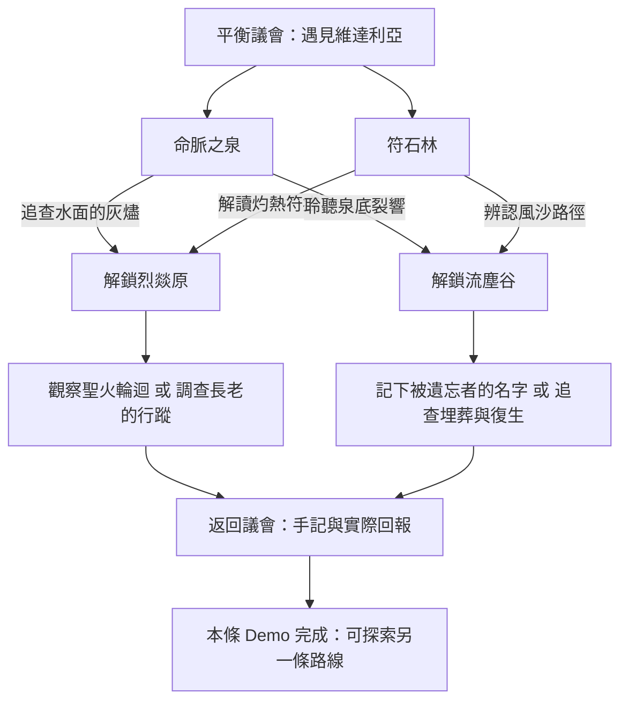
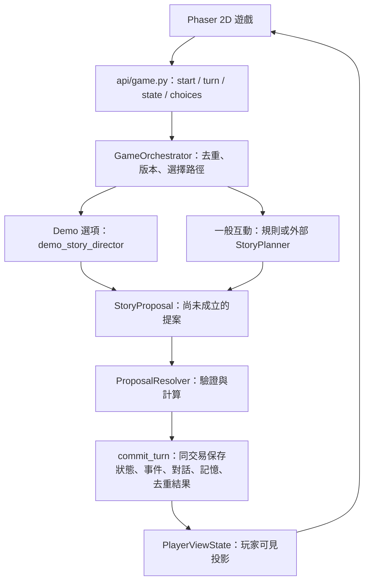

# RAG NPC Game｜夢龍世界探索原型

更新：2026-11-12（Asia/Taipei）。目前主遊戲改為 **Phaser 2D 探索＋固定寫實場景圖庫＋故事選項換場＋持久化回合**，入口為 <http://localhost:3200>。舊 3D 網址導回首頁；3D／Hunyuan 留作歷史原型，不再是遊玩依賴。正式敘事 LLM／RAG、第二幕與五結局尚未完成整合。

美術保留既有末世寫實／奇幻遺跡風格，只在遊戲端降低背景取樣解析度，沒有換成可愛手繪。五張場景各有 Tiled 可走區與互動點，M 地圖、J 手記和調查選項已接入 2D。人物、場景與存檔均沿用現有成果。固定圖庫由後端 Scene Registry 維護，故事選項決定合法換場，不需 VPN 或 GPU 才能遊玩。

這份 README 說明目前程式；原始設定見 [世界設計](docs/GENERATIVE_WORLD_DESIGN.md)，操作與交接見 [Demo 交接](docs/DEMO_HANDOFF.md)，歷史進度見 [PROGRESS](docs/PROGRESS.md)。舊進度百分比只代表當時驗收範圍，不代表整個遊戲完成。

完整平台的目標設計見 [系統架構總圖與判斷流程](docs/SYSTEM_ARCHITECTURE.md)，內含可下載的 SVG／PNG、回合判斷、資料庫分工、RAG 邊界與非同步生成，並標示已實作／部分完成／待接入。

## 1. 遊戲情境與目標

玩家暫從鳴霖的平衡議會進入遊戲，遇見維達利亞。命脈之泉長久沒有向外延伸，林地與符石出現異象。玩家走近人物交談、到現場調查，根據線索選擇前往烈燚原或流塵谷，再帶著實際結果回報。開場不直接告知玩家所有世界真相。

目標玩法是維持世界觀、角色核心人格與能力限制，讓反應、事件、任務及通往結局的過程隨玩家選擇發展：**生成器提出可能發生的事，程式判定哪些成立，資料庫保存結果，下一回合承接。** 目前主要調查節點仍預先定義，尚未達到完整自由生成故事的目標。

| 角色 | 設定方向與目前出場情況 |
| --- | --- |
| 維達利亞 | 鳴霖精靈領袖與議會調解人，守護泉眼、引導調查並接收回報。2D 可互動。 |
| 安德烈 | 鳴霖邊界調查官的公開原型設定；2D 有人物及異象／路線選項。 |
| 門梅司文托 | 流塵谷的名字／記憶記錄者，2D 有出場。深層動機與真相需按條件揭露。 |
| 維塔、火焰長老及其他勢力 | 已有世界設定或規則草案；維塔另有獨立預覽。尚未形成完整可玩的角色、任務與結局流程。 |

三位已登記 NPC 的初始 `private_profile` 目前都是空的，完整人格、語氣、能力及秘密權限卡尚未匯入。公開職稱與幾句回覆不能代替正式角色設定。

<details>
<summary>作者層世界設定與五種預定結局（含劇透，並非開場玩家已知資訊）</summary>

這是真實存在的封閉空間，由維塔的意識維持，不是醒來便消失的虛幻世界。設定包含精靈不死、人族輪迴、木乃伊復活，以及人與木乃伊透過埋葬／聖火轉化的關係。主角來自外部組織，身分與用途需逐步揭露。世界發生的事，不等於每位 NPC 都知道。

| 預定結局 | 設定結果 |
| --- | --- |
| 長眠 | 維塔繼續沉睡，既有規則與輪迴延續。 |
| 醒來 | 結界破裂，世界仍存在，居民只剩一條命。 |
| 篡夢 | 長老或外部組織奪走維塔力量。 |
| 新夢 | 主角協助維塔重新創造，世界持續擴展。 |
| 塵歸 | 主角抹除自己，入侵停止，世界恢復平靜。 |

五種結局已有設計與 C 的規則模組，尚未接成目前 API 的完整遊戲流程。使用者已確認「主角死亡即遊戲結束」；舊 C 模組仍有死後轉化邏輯，需協調修正後再整合。正式開場、完整知識卡與部分數值門檻仍待確認。

</details>

## 2. 現在怎麼玩

主要網址：**<http://localhost:3200>**。`/experiments` 與 `/experiments/babylon` 會導回同一個 2D 遊戲，舊 3D 程式保留作歷史原型。`/preview/veta` 仍是獨立美術預覽，未接主故事。

| 操作 | 功能 |
| --- | --- |
| WASD／方向鍵、點地面 | 自由移動；中文輸入法使用實體鍵碼，輸入框內不移動。 |
| 點人物／發光地標 | 先步行接近，再開啟交談／調查；也可走近後按 E。 |
| M／旅途地圖 | 看五地預覽、已解鎖地點、下一步與合法旅行選項；遠處追蹤先步行，抵達後確認。 |
| J／手記 | 看實際調查及來源，回議會後可走近維達利亞回報。 |
| 右鍵、Q／R | 原地轉身。 |
| 滾輪、＋／－、雙指 | 地圖縮放；手機直向畫面會隨玩家移動。 |
| Esc | 關閉對話、地圖、手記或說明。 |
| 音樂、麥克風、朗讀 | 場景配樂；NPC 對話支援瀏覽器 STT／TTS，受裝置支援與權限影響。 |
| 重新開始 ↺ | 建立新 Session，舊存檔保留。 |

場景、回合、線索、背包、事件、對話與 NPC 記憶保存在 SQLite；重整／重啟可承接。連續步行座標暫不保存，重載回到目前場景入口。

## 3. 固定場景與故事線

| 場景 | 圖片內容與互動 |
| --- | --- |
| 平衡議會 `minglin` | 原森林圓形祭壇、石板路、水池；維達利亞與安德烈。 |
| 命脈之泉 `minglin_life_spring` | 泉池、瀑布、古石岸；走近岸邊調查灰燼或裂響。 |
| 符石林 `minglin_rune_grove` | 古樹、發光符石與石路；調查灼熱符痕或風沙方向。 |
| 流塵谷 `liuchen_valley` | 荒原、龜裂地表、遺跡與風沙；與門梅司文托交談、調查名字及埋葬。 |
| 烈燚原 `lieyi_plains` | 熔流、玄武岩道路、聖火祭壇；調查聖火與長老行蹤。 |

五地各有自己的 Tiled 地圖、可走範圍、出生點與角色／地標，URL 由 `backend/content/scenes.py` 統一提供。人物比例、原畫構圖與寫實風格保留；背景在遊戲內以 836×471 取樣再放大，降低過度細碎的清晰度，沒有重新畫成可愛風格。符石林與烈燚原的正式世界細節仍待確認，產品介面只描述可觀察景象。

### 可玩的調查分支



不同選擇會保存不同線索、開放不同路線、顯示不同調查標記。回報時維達利亞只整理實際建立的公開紀錄；私下調查不直接變成她的記憶，需透過回報事件得知。「下一章待續」是目前內容邊界，未連到正式第二幕或五結局。

### 故事與圖庫如何配合

**固定圖庫 → 故事提供選項 → 玩家選擇 → 後端驗證與保存 → 切換對應圖片／地圖。** 同一張背景可承接不同對話、線索及任務狀態，圖片不需要每回合重生。

| 部分 | 現在的實作 |
| --- | --- |
| 調查主線 | `demo_story.py` 的既有條件與分支，經驗證後推進；目前不是 LLM 即興創作。 |
| 一般 NPC 互動 | 規則 planner 依輸入、回合、記憶、承諾與任務產生回覆／提案。 |
| 真正模型／RAG | adapter 與權限資料結構已有；B 的正式服務尚未接入。後續還需將生成的候選選項與事件驗證、保存，才能接續完整故事。 |
| 場景圖 | 由已登記的場景 ID 選固定背景、配樂與 Tiled 地圖，前端不呼叫即時圖片或 GLB 工作。 |
| 過去的 Hunyuan／世界指令 | 留在歷史原型及原分支，主遊戲停用；本輪不再依賴 3D 或 GPU。 |

原素材來源與提示見 [場景插畫](docs/SCENE_ASSET_PROMPTS.md)、[場景 manifest](frontend/public/game/scenes/manifest.json)。本輪只改顯示取樣與互動，原始圖片檔案未重寫。

## 4. 整體程式架構

### 資料夾地圖

```text
rag-npc-game/
├── backend/                         FastAPI 與權威遊戲邏輯
│   ├── main.py                      啟動、遷移、服務組裝、CORS
│   ├── api/                         HTTP：遊戲、角色、能力、健康、3D 工作／下載
│   ├── orchestration/               回合協調、選項、Demo 導演、世界指令解析
│   ├── content/                     角色／地點、配置、線索、揭露規則、授權背景查詢
│   ├── schemas/                     Pydantic：行動、提案、操作、狀態、記憶、玩家投影
│   ├── generation/                  規則 planner、模型 adapter、2D／3D 工作處理
│   ├── modules/                     現行 ProposalResolver 與待整合的 C 引擎
│   ├── rules/                       C 的固定事件、數值、階段與結局規則草案
│   ├── database/                    SQLAlchemy 表、Session、repository、交易、遷移入口
│   └── prompts/                     解析／結局模板，未接成現行完整主流程
├── frontend/                        Next.js、React、Phaser、Babylon.js
│   ├── app/
│   │   ├── page.tsx                 /：2D UI、對話、瀏覽器語音與回合送出
│   │   ├── layout.tsx               共用頁面殼與全域樣式入口
│   │   ├── globals.css              共用與 2D 介面樣式
│   │   ├── experiments/page.tsx     舊路徑轉到 2D 首頁
│   │   ├── experiments/babylon/     舊 3D 路徑轉到 2D 首頁
│   │   └── preview/veta/            維塔預覽、layout 與專用樣式
│   ├── components/
│   │   ├── MinglinGame.tsx          Phaser 人物、移動、地標、Tiled、碰撞與背景取樣
│   │   ├── WorldMap.tsx             旅途地圖，顯示後端合法路線
│   │   └── experiments/             歷史 3D UI、控制、渲染與材質（主遊戲停用）
│   ├── lib/                         共用 API 型別／請求、Session key、配樂與播放 hook
│   └── public/
│       ├── audio/                   場景音樂與維塔配樂
│       ├── images/                  NPC 肖像等靜態圖
│       └── game/                    森林素材、人物去背、旅途地圖、五份 .tmj
│           ├── scenes/              四張地點插畫與 manifest
│           ├── models/              預設 GLB、manifest、references/ 生成參考圖
│           └── materials/           沙土、玄武岩等材質
├── infra/hunyuan3d/                  歷史 GPU Docker 與生成服務（主遊戲不依賴）
├── migrations/                      Alembic env.py、模板與 versions/ 七次遷移
├── scripts/                         離線更新預設 GLB 與 manifest 的腳本
├── tests/                           後端契約、交易、規則、adapter、失敗回復測試
│   └── frontend/                    第一人稱操作與模型尺寸的 Node 測試
├── docs/                            世界設計、契約、交接、素材來源、部署與進度
│   └── qa/                          分階段瀏覽器截圖與驗收步驟
├── data/                            本機 game.db、generated_assets/；不提交執行資料
├── requirements.txt                 後端依賴；requirements-dev.txt 為測試依賴
├── alembic.ini                      資料庫遷移設定
└── .python-version                  Python 版本；前端依賴在 frontend/package*.json
```

`.venv/`、`frontend/node_modules/`、`frontend/.next/` 與快取是本機環境／建置產物。金鑰放被忽略的本機 `.env`，不放程式或文件；後端目前不自動載入根目錄 `.env`，啟動時需將變數帶入程序。前端設定檔為 `frontend/.env.local`。

### 一個回合從哪裡經過



兩條提案路徑共用規則與交易邊界。`/start` 建立／恢復 Session；每個新行動有 `action_id`，不確定成功時保留原 ID 重送。相同 ID／內容重播原結果；同 ID 換內容或過期 `expected_state_version` 回傳 409，不重複增加回合或物品。歷史世界指令 API 保留於後端，2D 主遊戲不提供入口。

模型呼叫在提交交易前完成；客觀結果來自核准操作與系統敘事。NPC 發言不能直接增加背包或改寫設定，接真實模型後仍需測試台詞是否聲稱了未核准結果。

目前畫面只讀取已提交狀態中的 `current_scene.background_url` 與 `tilemap_url`。故事選項不能只在前端硬切圖片，仍須通過 Scene Registry、選項內容及版本驗證，保存事件後才切畫面。舊圖片／3D 工作管線保留於歷史程式，沒有加入當前遊玩流程。

### 要改哪種邏輯，就看哪個檔案

下列位置均相對於專案根目錄。

| 要改的事情 | 邏輯位置與責任 |
| --- | --- |
| Demo 分支、條件、台詞與線索 | `backend/content/demo_story.py` 定義內容；`backend/orchestration/demo_story_director.py` 轉提案，不在前端按鈕裡改狀態。 |
| 選項、NPC 詢問與下一步 | `backend/orchestration/player_choices.py`；`backend/schemas/player_view.py` 將公開路線投影給地圖。 |
| 地名、ID、合法出口、地圖座標 | `backend/content/scenes.py` 是單一 Scene Registry。 |
| 物件分布、出生／互動點、核心地標 | `backend/content/world_scenes.py`；可調欄位／上限在 `backend/schemas/world_scene.py`。 |
| 世界指令句型 | `backend/orchestration/world_commands.py` 只提出受限配置操作。 |
| 歷史 3D 原型（停用） | `frontend/components/experiments/TrialExperience.tsx`；按鍵／點擊步行在同目錄 `first-person.ts`。 |
| 地形、光照、模型載入、碰撞 | `frontend/components/experiments/babylon-driver.ts`；`world.ts` 共用高度與 driver 契約，`asset-layout.ts` 檢查模型尺寸。 |
| 歷史 3D 森林主景（停用） | `frontend/components/experiments/forest-sanctuary.ts`；`sanctuary-layout.ts` 共用水池範圍，`water-material.ts` 共用水材質；樣式在 `TrialExperience.module.css`。 |
| 手記、回報、防劇透 | `backend/content/story_findings.py` 推導紀錄，`reveal_policy.py` 控制公開用語；前端 `InvestigationJournal.tsx` 呈現。 |
| 角色與知識權限 | `backend/content/characters.py`、`backend/schemas/content.py`、`backend/content/context_repository.py`；依 NPC、Session、解鎖及回合過濾。 |
| B 的模型、背景組合、逾時重試 | `backend/generation/config.py` 組裝，`gateway.py` 定義契約，`planner.py` 整理授權背景；`http_gateway.py`／`openai_compatible_gateway.py` 呼叫服務。 |
| 合法事件、所有權、承諾、任務、換場 | `backend/modules/proposal_resolver.py`；操作格式在 `backend/schemas/story.py`。 |
| 回合協調與執行分流 | `backend/orchestration/game_orchestrator.py`，目前解析仍是簡化版本，尚未完整接 C 的 InputEngine。 |
| Session、交易、事件、對話、目擊記憶、去重 | `backend/database/repository.py`；資料表在 `models.py`，連線在 `session.py`。 |
| C 的數值、危險事件、換幕與結局 | `backend/rules/`，以及 `backend/modules/input_engine.py`、`action_validator.py`、`state_manager.py`、`ending_engine.py`。已有模組，**現行 GameOrchestrator 未呼叫這套完整流程**。 |
| 3D 工作與 GPU 服務 | `backend/generation/scene_assets.py` 處理 job／GLB；`infra/hunyuan3d/server.py` 執行 Hunyuan；`scripts/generate_scene_models.py` 更新離線資產。 |
| 2D 圖片工作 | `backend/generation/image_gateway.py` 定義介面，`scene_image_jobs.py` 處理保存、工作與 fallback；尚無正式 provider 注入。 |
| 目前 2D 人物、地標、取樣、語音／對話 | `frontend/components/MinglinGame.tsx`、`frontend/app/page.tsx`；`.tmj` 的 Actors／Walkable 定義人物、地標與可走區域；`tilemap_url` 由後端提供。 |
| 共用 API／Session、配樂 | `frontend/lib/game-api.ts`；`scene-music.ts`、`use-scene-music.ts`。 |

### 資料實際保存在哪裡

| 類別 | 程式／資料表 |
| --- | --- |
| 不可由普通生成改寫的設定 | `world_canon`、`character_definitions`。已有格式與表，不代表完整原始設定已匯入；初始公開角色在 `content/characters.py`。 |
| 可變世界狀態 | `game_sessions.state_json` 保存 `GameState`：背包、所在場景、故事進度、場景配置；版本供併發檢查。 |
| 事件、對話、請求紀錄 | `game_events`、`dialogue_records`；`action_records` 保存摘要、結果與私有提案核准／拒絕稽核。 |
| NPC 知識與記憶 | `knowledge_records`、`memory_records` 含角色、來源與時間；目擊或回報後建立對應記憶。 |
| 目標、承諾、任務 | `npc_goals`、`commitments`、`quests` 有來源、期限與狀態；已有資料與背景查詢，尚非完整自主世界模擬。 |
| 圖片／模型工作 | `scene_image_jobs`、`scene_asset_jobs`；GLB 檔另存本機執行目錄。 |

玩家 API 的 `PlayerViewState` 不含 NPC 私人記憶、關係數值、隱藏旗標或作者真相。前端不能直接讀寫資料表或任意 patch `GameState`。世界設計 Markdown 也尚未自動轉成授權 RAG 資料。

## 5. 尚缺工作與交接責任

| 優先 | 工作 | 負責方 |
| --- | --- | --- |
| 1 | 真正故事 LLM／RAG、完整角色與知識來源；將生成事件／候選選項通過驗證、保存並跨回合承接。 | B／D／作者 |
| 2 | 正式第二／三幕、危險事件、死亡即結束、五結局；修正舊死後轉化規則再整合。 | C／D／A |
| 3 | 擴充固定場景圖庫與地圖，按事件狀態選合適版本；每張圖需校正可走區、角色、調查點，維持末世寫實與一致比例。 | A／D／作者／美術 |
| 4 | NPC 自主行動、任務完整生命週期、連續座標保存與正式多人存取權。 | B／C／D |
| 5 | 投影／手機／瀏覽器語音實機驗收與效能調整。 | A／D |

3D、NPC 骨架動畫、即時 GLB／插畫生成暫停，不是目前固定圖庫玩法的前置條件。世界設定 Markdown 尚未自動變成模型授權知識；不能把現有規則分支標成真正 AI 自由生成。

## 6. 本機啟動與設定

需要 Python 3.12、Node.js 20.9+。以下依賴裝在本機專案環境；GPU 主機依賴一律放 Docker，不直接在主機執行 apt／pip／npm 安裝。

後端（專案根目錄）：

```bash
python3.12 -m venv .venv
./.venv/bin/pip install -r requirements.txt
./.venv/bin/uvicorn backend.main:app --reload --port 8300
```

前端（另一個終端）：

```bash
cd frontend
npm ci
npm run dev
```

production 展示：`npm run build` 後執行 `npm run start`，仍在 3200；不要同時啟動 dev 與 start 占同一埠。前端預設連 8300；要改位置，將 `frontend/.env.example` 複製為 `.env.local`，設定 `NEXT_PUBLIC_API_URL`。

後端啟動會執行 Alembic 遷移，預設 SQLite 為 `data/game.db`；可用 `DATABASE_URL` 改位置。手動遷移：`./.venv/bin/alembic upgrade head`。不要提交本機資料庫。

### 歷史 GPU 原型

2D 主遊戲不需設定 `HUNYUAN3D_URL`，也不需 VPN 或 SSH tunnel。舊 Docker 與量測保留在 [GPU 原型文件](docs/HUNYUAN3D_GPU_SETUP.md)，供歷史查閱；目前不繼續擴充。

### 接 B 的敘事模型

目前尚無正式端點，以下只表示設定介面，值由 B 提供，不代表已接通：

```bash
export MODEL_GATEWAY_PROVIDER=openai_compatible
export MODEL_GATEWAY_URL='<B 的 OpenAI 相容服務基底 URL>'
export MODEL_GATEWAY_MODEL='<B 提供的模型名稱>'
# 若需要金鑰，以本機安全方式設定 MODEL_GATEWAY_API_KEY，勿提交。
./.venv/bin/uvicorn backend.main:app --reload --port 8300
```

也支援 `contract_http` 自訂契約；URL 未設定採規則 planner，錯誤端點不會當成生成成功。預設呼叫逾時 15 秒、最多兩次嘗試；見 [MODEL_GATEWAY_CONTRACT](docs/MODEL_GATEWAY_CONTRACT.md)。

## 7. API 與驗收

| API | 用途 |
| --- | --- |
| `GET /health`、`GET /api/capabilities` | 健康與生成模式；RAG／外部語音 pending 不代表 2D 瀏覽器語音不存在。 |
| `GET /api/characters/{npc_id}` | 已登記角色公開資料。 |
| `POST /api/game/start` | 建立／恢復 Session。 |
| `POST /api/game/turn` | 提交 action_id、預期版本與行動模式。 |
| `GET /api/game/{session_id}/state` | 公開狀態、場景、手記、地圖及下一步。 |
| `GET /api/game/{session_id}/choices` | 情境選項；npc_id 可為 vidalia／andre／menmesvento。 |
| `GET /api/game/{session_id}/quests` | 玩家可見的未結束任務。 |
| `POST /api/game/{session_id}/scene-image`、`GET .../scene-image/{job_id}` | 2D 圖片工作；未設定 provider 使用版本化場景。 |
| `POST /api/game/{session_id}/scene-assets`、`GET .../scene-assets/{job_id}` | 3D 工作建立、輪詢；POST 要帶 expected_state_version。 |
| `GET /api/game/{session_id}/scene-assets/{job_id}/model` | 取得該 Session 成功工作的 GLB。 |

最近一次功能驗收（2026-11-12）：**125 個後端測試、既有 11 個前端邏輯測試、Next.js production build 通過**。Chrome 實際走兩條 2D 分支、四項紀錄與回報、重整／重啟承接、中文輸入法、地圖與手記。2D 的操作另由瀏覽器驗收，既有 Node 控制測試仍包含歷史 3D 測試；這些不代表正式 LLM／結局完成。

```bash
# 專案根目錄：後端與前端邏輯測試
./.venv/bin/pip install -r requirements-dev.txt
PYTHONPATH=. ./.venv/bin/pytest -q
node --experimental-strip-types --test tests/frontend/*.test.ts

# 前端 production build
cd frontend
npm run build
```

Node 控制測試需使用支援 `--experimental-strip-types` 的版本；Next.js 最低 Node 版本不等於支援此測試旗標。

| 文件／證據 | 內容 |
| --- | --- |
| [最新 2D QA](docs/qa/2d-exploration/README.md) | 固定圖庫、五地調查、兩條分支、手記、移動及手機。 |
| [地圖 QA](docs/qa/world-map/README.md)、[森林 QA](docs/qa/forest-sanctuary/README.md) | 路線、承接、原版主景與操作。 |
| [音樂資產](docs/AUDIO_ASSETS.md) | 曲目、來源、授權、雜湊。 |
| [B AI／RAG 交接](docs/B_AI_RAG_HANDOFF.md) | 模型、資料、檢索與驗收交付。 |
| [A／D Demo 交接](docs/DEMO_HANDOFF.md) | 展示、環境、限制、下一位接手事項。 |

A 負責前端、遊戲畫面與語音；B 負責模型與 RAG；C 負責行為解析、規則與結局；D 負責 API、Session、資料庫、Orchestrator、記憶及整合。共用 Schema 由 D 整合；涉及設定或 C 的規則先協調，不在前端另寫一套權威邏輯。
