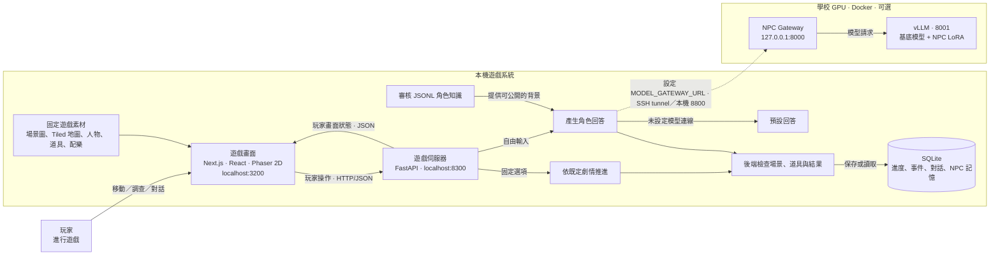

# 目前主遊戲系統架構

更新：2026-11-28。此圖描述本機分支目前的 **2D 主遊戲**；GPU 路徑為設定服務連線後才啟用的選項。可直接使用 [PNG 展示圖](diagrams/current-system-architecture.png) 或 [SVG 向量圖](diagrams/current-system-architecture.svg) 放進簡報，也可編輯 [Mermaid 原稿](diagrams/current-system-architecture.mmd)。圖面參照 [C4 Container Diagram](https://c4model.com/diagrams/container) 的系統邊界與責任分區，並依 [C4 Notation](https://c4model.com/diagrams/notation) 標出連線方向與用途。

## 展示時可這樣說

1. 玩家在 2D 畫面移動、調查，或與角色對話；操作會送到遊戲伺服器。
2. 伺服器確認玩家目前走到哪裡，以及這一步能做什麼。點選故事選項會走既定劇情；自由輸入則取得角色回覆。
3. 如果有連上學校 GPU，角色可以用訓練模型回答；沒有連上時，遊戲會用預設回答。
4. 伺服器檢查回答和行動是否符合劇情規則，再保存進度並更新玩家畫面。AI 不能自己發道具或決定結局。

## 實作邊界

- GPU Docker 的 NPC Gateway 在遠端 `127.0.0.1:8000`，vLLM 在同一容器的 `8001`；本機通常用 SSH tunnel 的 `8800` 接 Gateway。這條路徑須另外啟動並設定，開啟網頁本身不代表模型已連線。
- 艾倫問答 `/alan/message` 與敘事數值判讀 `/narrate` 是獨立路徑；後者需設定 `NARRATIVE_GATEWAY_URL` 才啟用。
- 現在的「RAG」背景取自審核 JSONL、SQLite 知識與 NPC 記憶；**尚無 embedding／向量資料庫檢索**。
- 目前主畫面使用固定圖片與 Tiled 地圖。舊 3D／Hunyuan3D 程式保留在專案內，**不在這張主遊戲流程圖中**。
- 故事的四階段自動推進與部分中段事件尚未完整接入主流程；圖中「Rules」表示已接入的驗證與結局能力，不表示草案全部完成。

主要程式入口：[前端頁面](../frontend/app/page.tsx)、[遊戲 API](../backend/api/game.py)、[回合協調](../backend/orchestration/game_orchestrator.py)、[結果核准](../backend/modules/proposal_resolver.py)、[角色背景](../backend/content/context_repository.py)、[GPU Gateway](../gpu_gateway/app.py)、[Docker 設定](../infra/npc_gateway/compose.yaml)。
