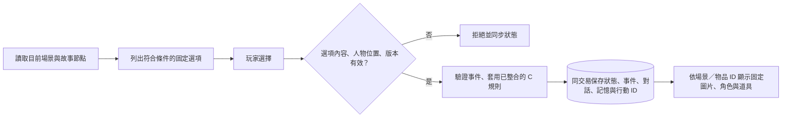
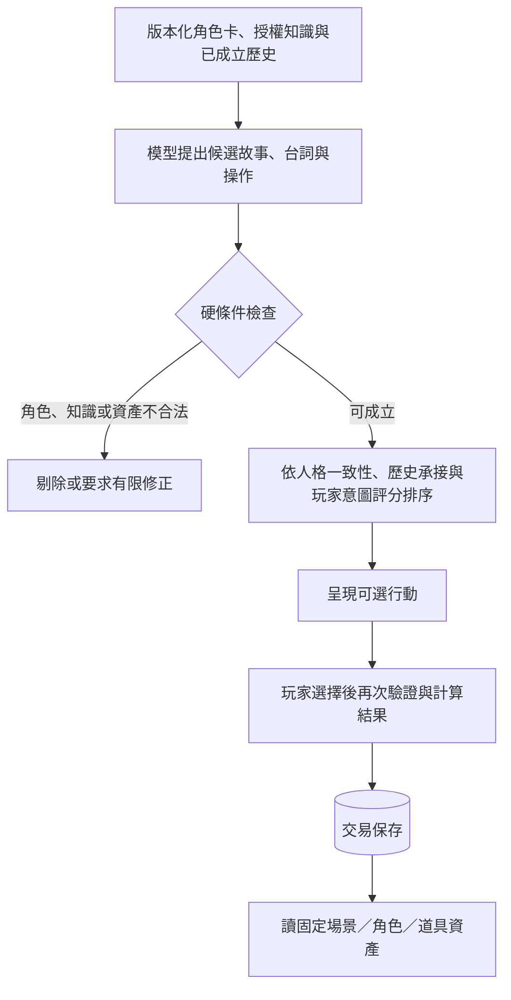

# 固定情境、資產對應與未來模型評分

更新：2026-11-12。現在先用固定選項與預寫答案完成可玩的情境；未來由模型提出候選發展。兩者共用事件驗證、交易、存檔與固定資產，不各建一套遊戲引擎。

## 現在的流程

| 情境 | 目前固定選項與成立結果 |
| --- | --- |
| 平衡議會 | 維達利亞說明異象、提供兩條路線；安德烈提供公開調查資訊。選旅行後換圖與 Tiled 地圖。 |
| 命脈之泉 | 維達利亞有兩個固定詢問；泉眼地標可查灰燼或裂響，分別開放烈燚原／流塵谷。交談與現場調查分開。 |
| 符石林 | 地標可解讀灼熱符痕或辨認風沙，對應相同兩個地區的不同線索來源。 |
| 烈燚原 | 達索固定詢問；聖火地標可觀察輪迴或調查長老行蹤。 |
| 流塵谷 | 門梅司文托固定詢問；選記名或埋葬調查，保存不同紀錄。 |
| 邊境廢墟 | 走訪兩地並返回議會後開放。走近塞特做三種抉擇；塞特／希拉另有公開詢問。抉擇只能成立一次。 |

同一張場景圖能承接不同選擇。人物由目前地圖的 Actors 放置，後端另驗證人物確實在場；兩邊的一致性由地圖契約測試檢查。介面最多呈現四個當下選項，劇情選項優先，其餘詢問可在後續狀態顯示。

## 邊境三種結果與道具

依使用者要求接續既有故事，這次只整合 C 的 `E2-3` 三個既定分支，沒有改寫 C 的數值表。

| 選擇 | 原規則 | 保存結果 |
| --- | --- | --- |
| 協助塞特與希拉 | `E2-3_help_both` | `fissure_map`、`library_path` 成立；背包取得一份固定裂隙地圖，手記增加圖書館路線線索。 |
| 通報長老會 | `E2-3_report` | 套用原有 axis −10、usurp +5 與 `elder_cooperation`，依 C 的 StateRules 封頂；不發地圖。 |
| 暫不介入 | `E2-3_ignore` | 記錄本次選擇，不發道具或額外路線。 |

每個旅程只能決定一次。重送同一 action 回傳相同結果；新 action 重選或回訪不再套數值、發物品。兩位在場人物取得目擊記憶，其他 NPC 不會自動知道。`PlayerViewState.player.items` 只描述玩家實際持有的物品；圖片存在不代表玩家已擁有。

目前可顯示地圖與圖書館的線索，但圖書館關卡、危險事件中使用地圖、其他中期事件及五結局尚未接入。這次重用 `EventRules` 與 `StateRules`；沒有啟用完整 `StateManager` 的強制換幕、真相保底或舊死後轉化流程。正式階段計數仍待 C 整合。

## 未來模型與評分的責任

- 核心人格來自角色設定；模型判斷當下反應與可能發展，不能自行改寫核心設定。
- 先檢查人物在場、知識授權、路線、物品所有權與前置條件，再評分排序；高分不能讓非法事件成立。
- 模型只引用已登記的場景、角色及道具 ID。評分影響推薦順序，不能替玩家選取不可逆的分支或發道具。
- 評分維度可包括人格一致性、因果承接、玩家意圖與重複程度；權重、門檻及標註案例由 B／C／D 對齊。目前沒有訓練或啟用評分器，不用假數字表示 AI 已完成。

## 維護位置

| 內容 | 單一維護位置 |
| --- | --- |
| 主情境、條件、固定結果與 C 規則對應 | `backend/content/demo_story.py` |
| NPC 固定詢問與預寫答案 | `backend/content/npc_dialogue.py`；一般規則回覆也引用同份文字 |
| 人物在場範圍 | `backend/content/characters.py` 的 `NPC_SCENES` |
| 場景與 Tiled／背景 URL | `backend/content/scenes.py` |
| 固定道具、圖片與取得規則 | `backend/content/items.py`、`frontend/public/game/items/` |
| 驗證與結果計算 | `backend/modules/proposal_resolver.py`，重用 C 的 `event_rules.py`／`state_rules.py` |
| 存檔及重播 | `backend/database/repository.py` |

不要在前端直接加背包、改旗標或硬切圖片；未來模型也使用同一個權威邊界。
