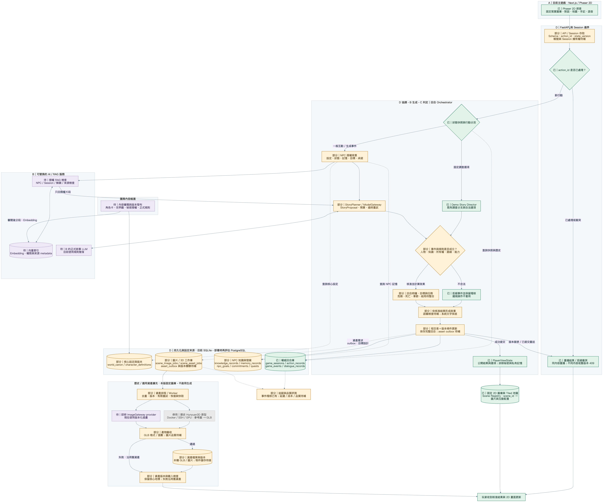
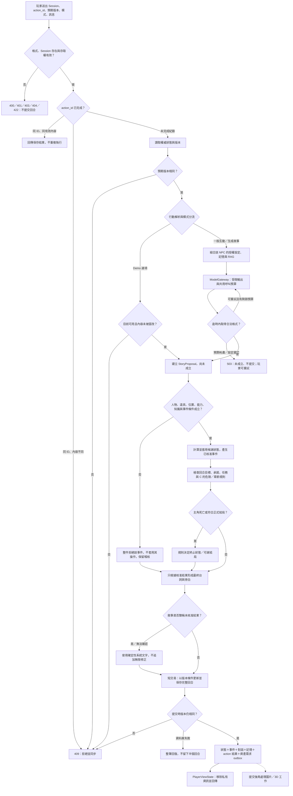
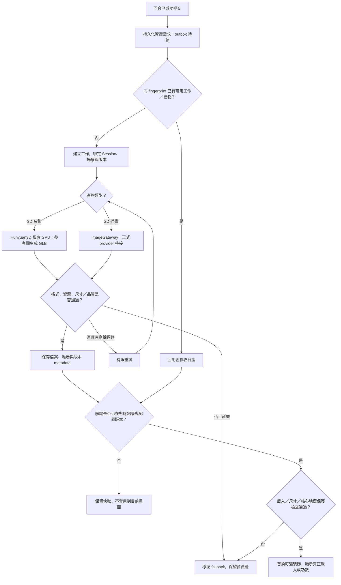

# 平台完整目標架構與實作對照

**2D 方向更新：主遊戲已改為固定寫實場景圖庫，由故事選項驗證、保存後切換背景與 Tiled 地圖。3D／Hunyuan 與即時圖片生成不在當前主流程中，相關管線僅保留為歷史／選用擴充。**

更新：2026-11-12（Asia/Taipei）。這是平台應有的完整設計，不代表圖中每個功能都已完成。採現有 Next.js＋FastAPI 的模組化架構，模型與生成服務可替換；目前不需要先拆成大量微服務。

**綠色／「已」**：核心能力已有並驗收；**黃色／「部分」**：已有基礎，圖中的完整責任尚待補齊；**紫色／「待」**：尚未接入。箭頭表示目標資料／呼叫流程，虛線表示查詢、記錄或非同步觸發，不代表已完成的連接；查詢箭頭指向資料來源，結果由同一查詢回傳。

## 1. 完整系統架構圖

[SVG 向量圖，可放大或放入簡報](diagrams/system-architecture.svg) · [Mermaid 可編輯原始碼](diagrams/system-architecture.mmd)

平台分成六個責任區：玩家介面、固定場景圖庫、API／Session、回合協調與判斷、模型／RAG、資料保存；非同步生成另為選用擴充。團隊維護的角色／世界資料另經審閱與版本發布，不由一般生成直接覆寫。

最重要的界線：**LLM 只能產生 StoryProposal；後端規則決定事實；SQL 保存權威結果；前端只呈現玩家可見資訊。** 向量資料庫是檢索索引，固定圖片／歷史 GLB 是呈現資產，兩者都不能替代權威遊戲狀態。

## 2. 每回合的完整判斷流程

以下是目標流程；帳號擁有權、完整 C 解析／危險事件、NPC 自主循環、模型敘事檢查與 outbox 尚需補齊。

### 判斷與失敗的語義

| 判斷 | 行為 |
| --- | --- |
| 身分與 Session 存取 | 目標設計先查存取權，再讀重播結果；目前只有 Session 流程，尚無完整帳號／擁有權驗證。 |
| 重複提交 | 已成功提交的同 ID／同內容重播原結果，不能再呼叫模型、加回合或發物品。 |
| 版本衝突 | 初查與提交時都檢查版本；衝突回 409，前端同步，不以舊候選狀態覆蓋新狀態。 |
| 模型逾時／格式失敗 | 只在共用預算內有限重試；耗盡則不提交。沒有正式模型設定時，使用明確標示的規則 planner。 |
| 規則拒絕事件 | 一個事件內的多個操作整件核准或拒絕；其他獨立事件仍可依設計處理。已處理的對話可保存為一回合，拒絕的效果不成立。這與格式錯誤的無效請求不同。 |
| 敘事不一致 | 只能描述已核准結果；沒有拿到物品就不能說已獲得。無法在預算內修正時，用系統文字保底。真正模型的語義檢查目前未完成。 |
| 主角死亡／結局 | 由 C 的正式規則判定，再保存終止狀態；不得由模型自行宣布。死亡即結束已確認，舊死後轉化不能直接接回。 |
| 資料庫或網路失敗 | 提交失敗整筆 rollback；提交成功但回應遺失時，保留原 action_id 重送，讀回原結果。 |

模型呼叫不持有長時間資料庫交易。正式生成若包含「事件提案＋最終敘事＋格式修正」，必須共享同一回合的呼叫上限；不能每一層各自重試而突破預算。現在 Gateway 預設最多兩次嘗試；完整自主與二次敘事尚需將全流程預算接起來。

## 3. 資料庫應分開保存什麼

目前 SQLAlchemy／SQLite 已有下列 13 張業務資料表，另有 Alembic 版本表。未來改資料庫引擎不應改變這些責任邊界。

| 分類 | 已有資料表 | 保存內容與邊界 |
| --- | --- | --- |
| 核心設定 | `world_canon`、`character_definitions` | 世界事實、角色核心設定、來源與版本；團隊維護。表與契約已有，完整原稿／角色卡尚未匯入。 |
| 當前狀態 | `game_sessions` | 權威 GameState 快照、所在場景、背包、內部旗標、故事進度、場景配置與 state_version。 |
| 去重與結果 | `action_records` | Session＋action_id 唯一鍵、有效內容摘要、完整回應、提案核准／拒絕紀錄。 |
| 已成立歷史 | `game_events`、`dialogue_records` | 事件原因、行動者、效果、目擊者、對話與旁白；不能用模型聊天記憶代替。 |
| 個別 NPC 所知 | `knowledge_records`、`memory_records` | 誰知道、相信、聽說或目擊什麼，以及來源／時間／解鎖條件；不同 NPC 不共享全部記憶。 |
| 長期發展 | `npc_goals`、`commitments`、`quests` | 目標、承諾、任務的來源、參與者、期限及狀態；有資料與查詢，不代表完整自主迴圈已完成。 |
| 資產工作 | `scene_image_jobs`、`scene_asset_jobs` | 狀態、fingerprint、嘗試數、錯誤與產物連結；GLB 二進位放檔案儲存。 |

建議新增而尚未實作的資料：

| 目標資料 | 用途 |
| --- | --- |
| `asset_outbox` | 與世界回合同交易保存「這個版本需要資產」的意圖，提交後才由 worker 排工作；避免玩家關頁就漏掉工作。 |
| 資產版本 metadata | 關聯 Session、scene_id、scene_revision、seed、內容雜湊、來源設定版本、job_id 與驗收狀態；避免舊工作蓋掉新場景。可擴充現有 job 表，不必先另建多套表。 |
| 帳號／Session 擁有權 | 正式多人平台的登入與存取權資料；目前的 Session 隔離不等於完整帳號系統。 |

**邏輯關係：** 一個 Session 對應多筆 action、事件、對話、記憶、目標、承諾、任務及資產工作；action 對應這次回合的事件與對話。角色定義與世界設定屬版本化來源，NPC 記憶附 NPC／Session／來源事件。具體外鍵以 `backend/database/models.py` 為準。

向量索引僅保存可檢索片段、embedding、來源 ID、設定版本與授權 metadata；它不是 SQL 的替代品。即使檢索回某件物品的描述，也不能因此把它放進玩家背包。

## 4. 模型與 RAG 的資料邊界

1. 團隊提供原稿與角色卡，標註事實、傳聞、秘密、來源及揭露條件，審閱後發布版本。
2. 對內容分段、建立 embedding 與索引；秘密與角色權限不能只寫在 prompt 裡。
3. 每回合先限定 NPC、Session、設定版本、解鎖條件及可用回合，才執行檢索。
4. 檢索結果再次檢查授權與來源，組合必要的核心設定、狀態摘要、該 NPC 的記憶及相關內容。
5. 模型只取得必要背景與操作白名單，產出結構化提案；不能直接改狀態、執行 SQL 或透過玩家文字解鎖秘密。
6. 規則驗證後，只有目擊者／收到回報者取得對應事件記憶；世界事實與 NPC 的主觀相信分開保存。

目前可用 `context_repository.py` 做 SQL 知識／記憶授權查詢；真正 embedding、向量索引與 B 的正式檢索服務仍未接入。模型 adapter 已有，正式 LLM 尚未就緒。

## 5. 歷史／選用的非同步生成（本版不啟用）

主劇情不等待 GPU；圖片／模型失敗不回滾已成立的文字回合。主要泉眼、中央符石、聖火底座、通路、出生點與互動範圍不能被任意裝飾生成破壞。

目前已有 job 保存、去重、恢復、有限重試、GLB 格式與面數檢查、前端尺寸／載入檢查、核心地標保護與失敗保留。尚缺與交易綁定的 outbox、部署用獨立 worker／租約、完整 revision metadata 與驗收標記。現行前端會取消過期場景的套用，但仍需補齊跨工作與部署層的版本約束。

## 6. 模組、負責人與目前完成邊界

| 區域 | 主要程式 | 負責與狀態 |
| --- | --- | --- |
| 玩家 UI | `frontend/app/page.tsx`、`WorldMap.tsx`、`MinglinGame.tsx`、`InvestigationJournal.tsx` | A：2D 主頁、固定圖庫、五地互動、語音與手記；舊 3D 路徑導回首頁。 |
| API／回合 | `backend/main.py`、`api/`、`orchestration/game_orchestrator.py` | D：正式回合、去重與版本已有；完整身分權限待補。 |
| 故事／世界指令 | `content/demo_story.py`、`demo_story_director.py`、`world_commands.py` | A／D：現有分支與受限指令已驗收。 |
| 設定／授權背景 | `content/characters.py`、`context_repository.py`、`schemas/content.py` | B／D／作者：SQL 邊界已有，完整內容、索引與維護介面待補。 |
| 模型 | `generation/gateway.py`、`planner.py`、兩個 HTTP adapter | B／D：adapter、結構驗證、逾時重試已有；正式 LLM／RAG 待接。 |
| 合法操作與結果 | `modules/proposal_resolver.py`、`schemas/story.py` | C／D：現行白名單核准已有；C 的完整數值與正式劇情尚未整合。 |
| 危險／章節／結局 | `backend/rules/`、C 的 `state_manager.py`／`ending_engine.py` 等 | C／D／A：有模組，但現行 Orchestrator 未接完整流程，且需修正舊死亡轉化。 |
| 交易／資料庫 | `database/repository.py`、`models.py`、`migrations/` | D：完整回合交易已有；目標設計新增 outbox／權限及工作版本資料。 |
| 資產生成 | `generation/scene_assets.py`、`scene_image_jobs.py`、`infra/hunyuan3d/` | A／D：Hunyuan 已通；即時插畫 provider、正式美術與部署 worker 尚缺。 |

補齊順序：**完整角色／規則與知識資料 → 接 B 的模型／RAG → 一個可跨回合承接的新生成事件 → 正式章節／死亡／結局 → 自主發展與資產部署強化**。可繼續以現有選項與版本化美術驗收，不把模型端點接通當成整個平台完成。

目前固定場景由 `current_scene.background_url`／`tilemap_url` 指向版本化檔案，前端不排生成工作。未來若另外啟用資產生成，再補上述 outbox、worker 與版本驗收，不能把它們當作這版 2D 遊戲的依賴。

## 7. 圖檔與閱讀入口

- `diagrams/system-architecture.mmd` 是總圖唯一可編輯來源；SVG／PNG 是同一來源的輸出，不另外手改圖中文字。
- Mermaid CLI 可將 `.mmd` 匯出 SVG 或 PNG；本次渲染工具僅裝在暫存目錄，未加入遊戲依賴或變動鎖檔。
- 系統現況與完整檔案導航：[README](../README.md)。
- B 的輸入輸出：[ModelGateway 契約](MODEL_GATEWAY_CONTRACT.md)、[B 交接](B_AI_RAG_HANDOFF.md)。
- 原始世界設定與揭露規則：[GENERATIVE_WORLD_DESIGN](GENERATIVE_WORLD_DESIGN.md)。

本文件是架構設計，並未實作紫色或黃色節點中的缺口；本次以圖形實際渲染、文字與程式責任核對、連結及 Git 差異檢查驗證。
