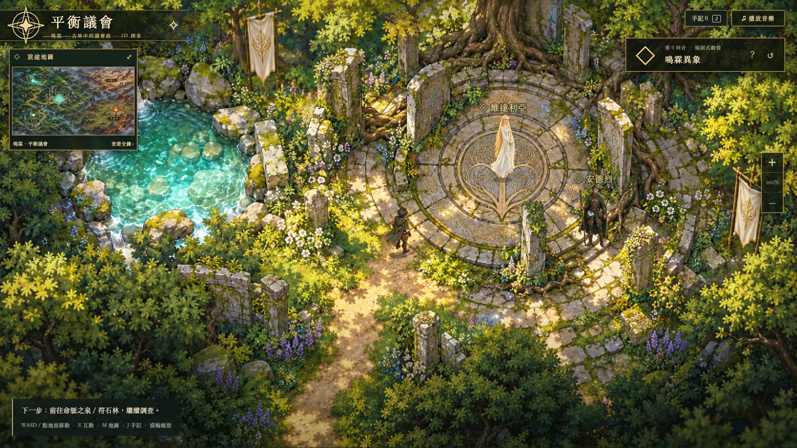
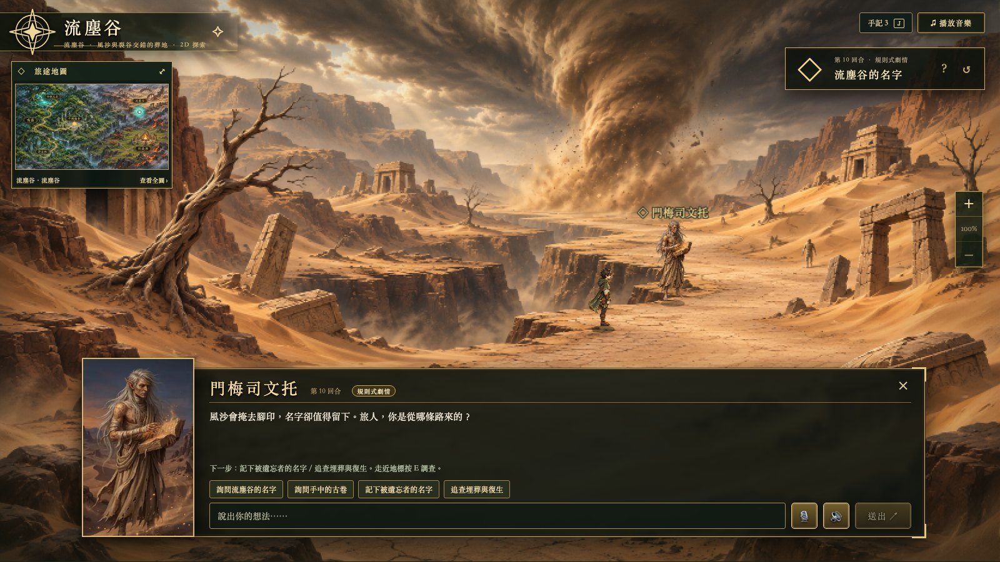
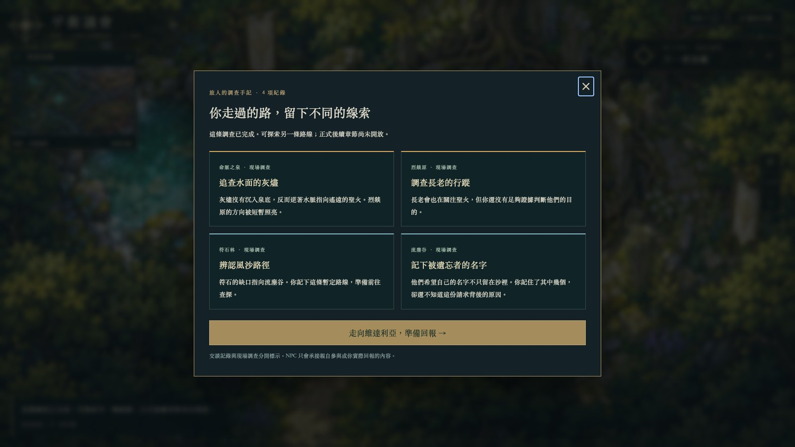
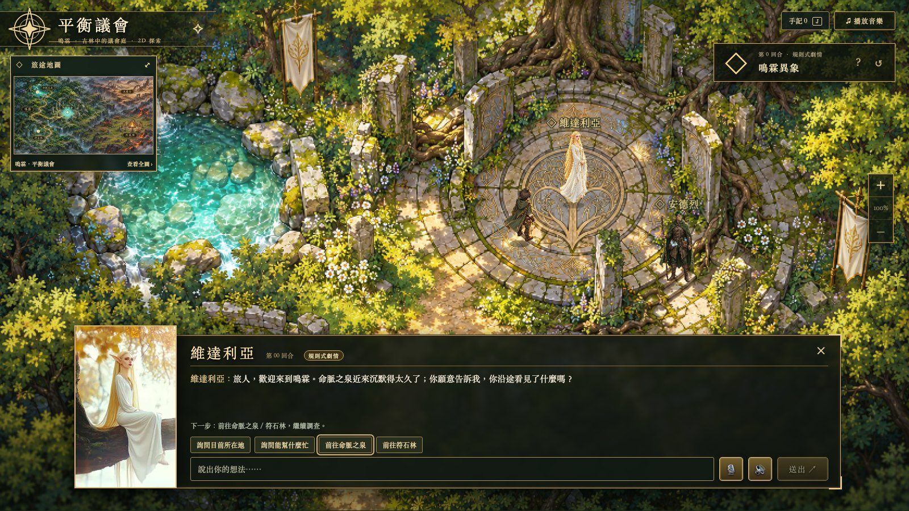
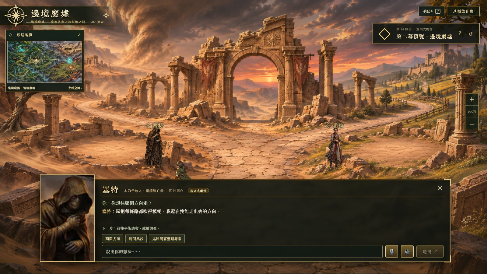
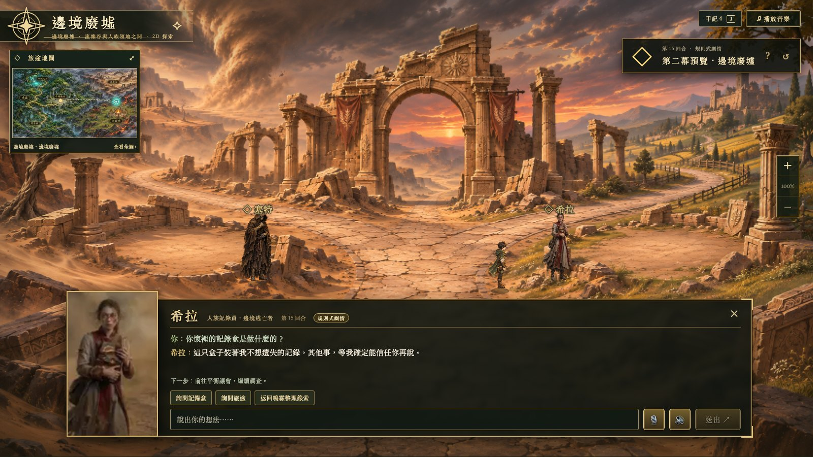
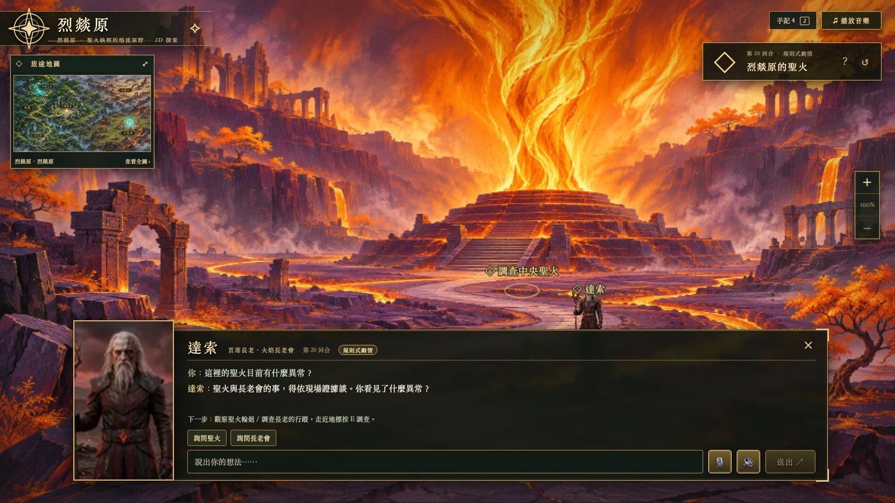
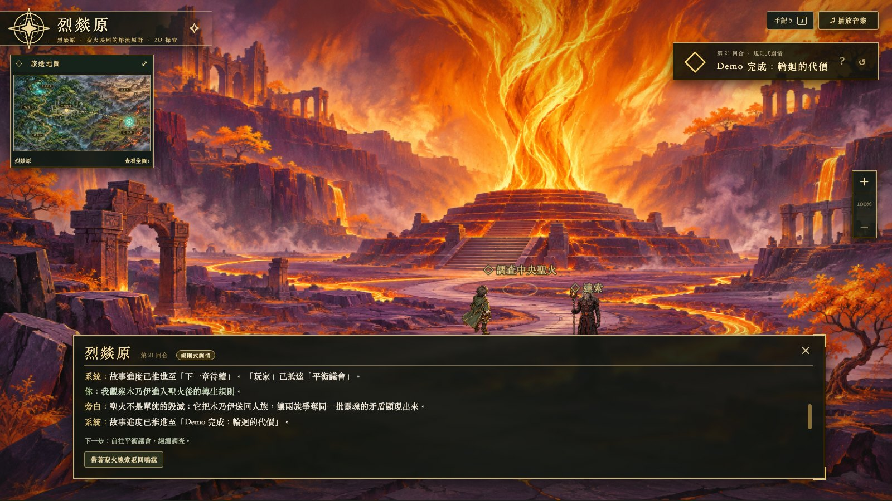

# 2D 固定場景遊戲驗收

2026-11-12；分支 `feat/2d-wasteland-game`。實際環境為 Next.js production `localhost:3200`、FastAPI `localhost:8300`、SQLite，以及獨立 Chrome／CDP 測試瀏覽器。桌面 1600×900，手機模擬 390×844；未變更使用者原瀏覽器存檔。

## 美術與場景

- 使用原始五張場景圖，沒有覆寫 PNG，也沒有加入可愛風格的生成預覽。Phaser 以 836×471 取樣背景並放大；人物、UI 保留原解析度。
- Scene Registry 為單一來源，公開 `background_url` 與 `tilemap_url`。議會、泉眼、符石林、流塵谷、烈燚原各有對應 Tiled 地圖、出生點與人物／地標。
- `/experiments`、`/experiments/babylon` 導回 2D 首頁；此流程未發出 scene-image／scene-assets 請求，不需要 VPN 或 GPU。



## 已走過的流程

| 驗收 | 實際結果 |
| --- | --- |
| 中文輸入法移動 | `Process`／`KeyW` 可移動；在 NPC 輸入框打 W 不移動玩家。 |
| 接近互動 | 點維達利亞先步行、抵達才開選項；泉眼、符石與聖火為地標調查，沒有假 NPC 肖像。 |
| 火焰分支 | 議會 → 泉眼 → 灰燼 → 烈燚原 → 長老行蹤 → 回議會 → 回報，手記及回應含本次紀錄。 |
| 風沙分支 | 同一旅程續走符石林 → 風沙 → 流塵谷 → 記名 → 返回；共四項調查紀錄，可與火焰分支比較。 |
| 地圖旅行 | 新旅程於遠處按 M 選泉眼、追蹤路線；步行至維達利亞後高亮選項，確認後 API 成功才進泉眼。 |
| 手記回報 | 遠處由 J 選回報，先走近維達利亞再確認；不把私下調查直接當作 NPC 已知。 |
| 版本衝突 | 另一請求先推進同一測試 Session，舊 UI 選項回 409 後同步狀態及選項，重新選擇可成功。 |
| 保存承接 | hard refresh 與後端重啟後，場景、回合及四項紀錄仍在；連續步行座標回入口，尚未保存。 |
| 手機 | 390×844 按 D 從 x835 經 x954 至 x1161，抵達安德烈附近；鏡頭跟隨，手記可捲動，無水平溢位。 |

操作期間 Chrome `Runtime.exceptionThrown` 為零。這是自動化瀏覽器實測；觸控雙指、麥克風權限、中文辨識及實際聲音輸出仍需使用者裝置驗收。







手機畫面：[探索與鏡頭跟隨](04-mobile-exploration.jpg)、[手記捲動](05-mobile-journal.jpg)。

## 自動檢查與完成邊界

```bash
PYTHONPATH=. ./.venv/bin/pytest -q
# 125 passed
node --experimental-strip-types --test tests/frontend/*.test.ts
# 11 passed（既有測試仍含歷史 3D 模組）
cd frontend
npm run build
# Next.js production build passed
```

新增 `tests/test_2d_scene_maps.py` 檢查五張地圖／背景不同、出生點合法、各互動點可由可走區到達，以及舊回合投影可恢復缺少的 `tilemap_url`。2D 按鍵、點擊、鏡頭與對話另外以以上瀏覽器流程驗收。

目前調查選項為規則分支，尚非 LLM 自由生成；B 的正式模型／RAG、第二／三幕、五結局與完整角色卡仍未整合。固定圖庫負責呈現地點，未來生成事件也需通過後端驗證，才能保存並選用對應場景。

## 合併最新 main 後補驗收

整合 `5ff4850` 的同學成果後，固定圖庫為六地，新增邊境廢墟與達索／塞特／希拉。泉眼與聖火仍有獨立調查地標，新增人物沿用同一套步行、近距離互動及回合 API；重複的泉眼／烈燚原地圖已合併。

Chrome 由先前四項紀錄存檔進入邊境預覽，走近塞特選「詢問去向」、走近希拉選「詢問記錄盒」，兩人分別回應。再返回議會，循泉眼灰燼到烈燚原，與達索談聖火；關閉交談後走近聖火調查，新增第五項紀錄。調查面板沒有 NPC 肖像，旁白未混入達索交談，瀏覽器例外為零。

合併後重新驗證：**130 個後端測試、12 個既有前端邏輯測試、production build 通過**。地圖可達性測試涵蓋六地；原先 125／11 的結果是本頁前半段五地階段紀錄。








