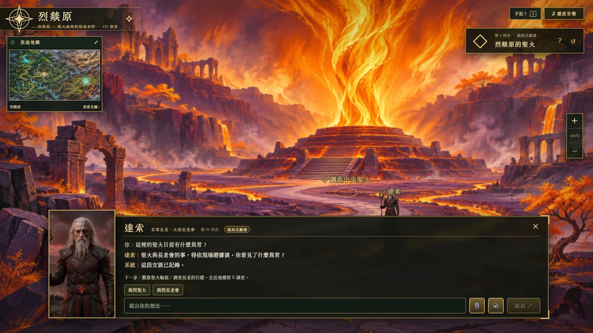
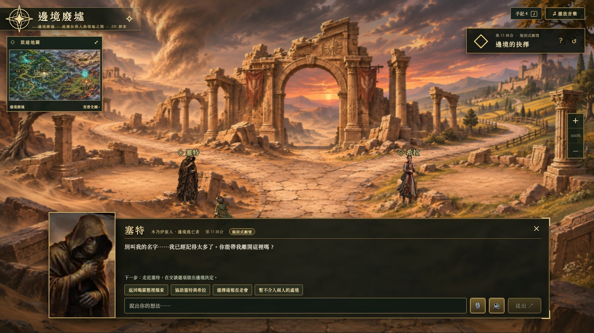
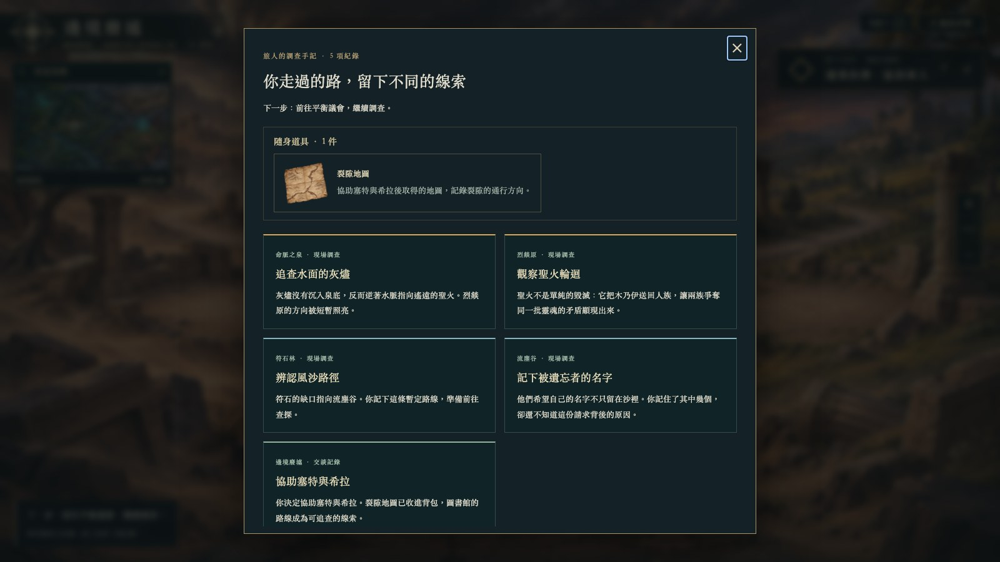
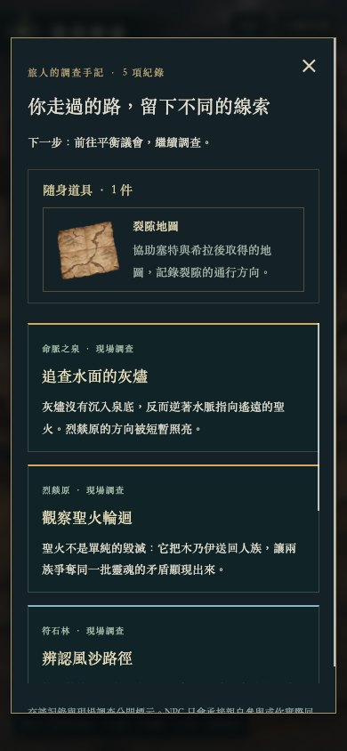

# 固定選項與背景柔化驗收

2026-11-12；分支 `feat/preset-story-choices`。Chrome／CDP 獨立測試瀏覽器，Next.js production 3200、FastAPI 8300。

## 背景柔化

背景仍取樣為 836×471，套用 0.55px Canvas 柔化與線性插值。只在背景載入時處理一次，人物、文字與原圖不變；未改變寫實比例或美術風格。

production build 通過。Chrome 1600×900 已實際查看森林、祭壇與水池，介面文字清楚。

## 固定選項與道具

Chrome 桌面實際操作：安德烈詢問 → 泉眼維達利亞詢問 → 灰燼 → 烈燚原達索詢問／聖火調查 → 返回 → 符石林風沙 → 流塵谷門梅司文托詢問／記名 → 返回 → 邊境塞特 → 協助兩人。人物先步行接近才互動，固定回答後不跳過原本調查節點。

協助後第 16 回合，J 顯示五項紀錄及一份裂隙地圖，名稱、說明與透明 PNG 正常。hard refresh 與實際重啟 Uvicorn 後，仍是相同回合、`border_choice_resolved` 與一張地圖；未被舊防劇透轉換改稱路標。

手機可捲動且沒有水平溢位；記錄到的遊戲 Runtime.exceptionThrown 為零。語音實機權限本輪未重測。

## 自動檢查

- `PYTHONPATH=. ./.venv/bin/pytest -q`：137 passed。
- `node --experimental-strip-types --test tests/frontend/*.test.ts`：12 passed，仍包含歷史 3D 邏輯，2D UI 另由 Chrome 驗收。
- `cd frontend` 後 `npm run build`：production build passed。

新測試以「呼叫模型就報錯」的替身走完整六地固定旅程與三種邊境結果。另驗證選項竄改、人物越場、同 action 原結果重播、互斥／回訪不重領、C 的原有數值／旗標、重啟與舊物品投影。模型嘗試在玩家僅說你好時代選獎勵，也不會發道具或播放成功旁白。

三種邊境結果均已用 API＋真實 SQLite 驗收；Chrome 的取物流程驗收協助分支。圖書館、其餘中期事件與結局、真正的 LLM／RAG／候選評分尚未完成，見 [流程與範圍](../../PRESET_STORY_FLOW.md)。
